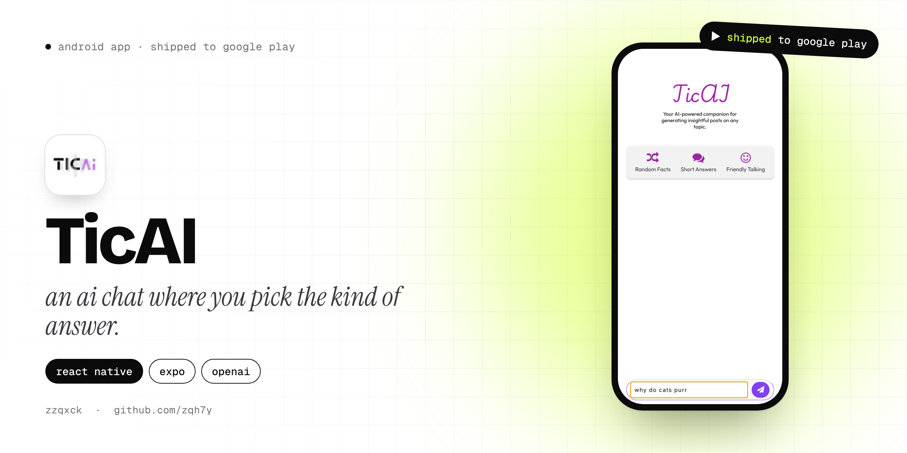
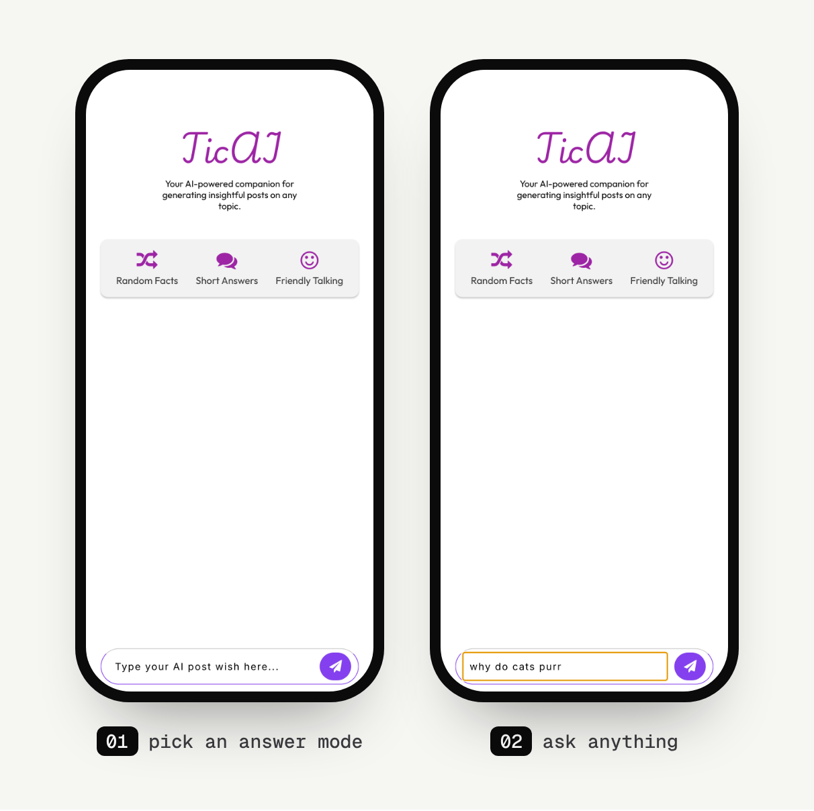

<p align="center">
  
</p>

<p align="center">
  
  
  
  
</p>

# TicAI

TicAI is an AI chat app where you decide what kind of answer you want before you ask. Instead of one assistant that always replies the same way, you pick a mode, like **Random Facts**, **Short Answers** or **Friendly Talking**, and the replies follow it. It was released on Google Play in 2024.

I started it in June 2024 with a note in this README that said *"gonna take this one really serious, till it works"*. The AI call itself was the easy part. Getting the chat to feel right (keeping context, formatting the answers, not letting people spam it) was the real work.

## Screens

<p align="center">
  
</p>

## Features

- **Answer modes.** Three quick modes on the home screen, plus a full mode picker (the *RequestsAI* screen) with a search box and two groups of modes. The current mode is shown above the chat and saved for next time.
- **It remembers the conversation.** Every message is sent together with the chat so far, so you can ask follow-up questions.
- **Readable answers.** Text wrapped in `**double stars**` in a reply is shown in bold.
- **Saved history.** The chat is stored on the phone and comes back when you reopen the app. You can clear it and start a new topic whenever you want.
- **Rate limit.** A cap of ten messages with a 60-second timer on screen, so one person can't burn through the API.
- **Error handling.** If the request fails you get a clear "could not process your request" message instead of a frozen screen.

## How it's built

| Part | Tech |
|---|---|
| Framework | React Native 0.74, Expo SDK 51 |
| Navigation | React Navigation (stack) |
| Storage | `@react-native-async-storage/async-storage` |
| AI | OpenAI, called through a small `queryOpenAI(prompt, mode)` helper |
| Fonts | Outfit, Play and a signature font, loaded with `expo-font` |

## About the branches

- **`master`** (default) has the newer chat screen with modes, context, the timer and saved history. A few files it imports aren't committed: the `openai` helper (it holds the API setup), `data/ModeList.js` and the `Timer` component. To run this version you'd add your own.
- **`main`** has the complete Expo project for the earlier version of the UI, with all its assets. It runs as-is, but the replies are placeholders because the AI call isn't in it yet. The screenshots above come from this version.

```bash
git clone -b main https://github.com/zqh7y/TicAI.git
cd TicAI
npm install
npx expo start
```

---

<p align="center">
  Made by <b>zzqxck</b> · <a href="https://zqh7y.github.io/Portfolio/">portfolio</a> · <a href="https://github.com/zqh7y">more projects</a>
</p>
